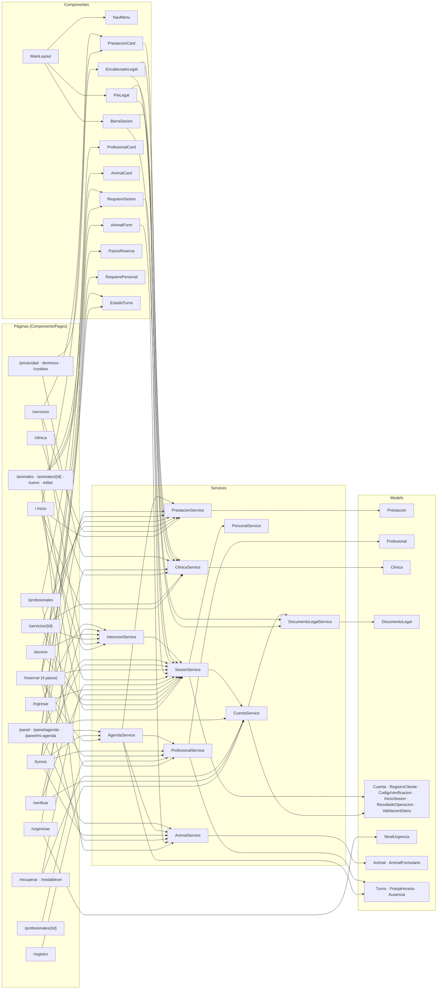

# Interfaz para computadora — `Veterinaria.Blazor`

Aplicación **Blazor Web App** en **C# / .NET 10** (interactividad Server, ubicación Global) para Visitante, Cliente, Recepción, Veterinario y Administración. Se construye en la sección A (rama `desktop`) con **datos de demostración** y se conecta a la API en la sección C.

- Abrir `Veterinaria.Blazor/Veterinaria.Blazor.slnx` en Visual Studio 2026 y ejecutar con **F5**.
- Reglas comunes: [principios vigentes](../docs/contexto-base/CONTEXTO_BASE.md#31-principios-vigentes). Convenciones del docente: [`AGENTS.md`](../AGENTS.md).
- Avance: [plan de tareas](../docs/analisis/PLAN_TAREAS_PROYECTO.md) y [bitácoras](../docs/sesiones/).

## Cómo está organizado

```
Veterinaria.Blazor/
├── Models/              Clases de datos (sin lógica): Prestacion, Profesional, Clinica, Cuenta…
├── Services/            Lógica y datos de demostración; cada uno se registra con AddScoped en Program.cs
├── Components/
│   ├── Layout/          MainLayout (marco de todas las páginas) y NavMenu (menú lateral)
│   ├── Pages/           Una página por ruta (@page)
│   └── *.razor          Componentes reutilizables: tarjetas, pie legal, barra de sesión…
├── wwwroot/             Archivos estáticos (Bootstrap, app.css)
└── Program.cs           Cultura es-UY y registro de servicios
```

Cada página **inyecta** (`@inject`) los servicios que necesita y **usa** componentes con `[Parameter]`. Los servicios trabajan con los modelos. En la sección C, cada `XxxService` se reemplaza por un `XxxApiService` que pide los mismos datos a la API con `HttpClient`, sin cambiar las páginas.

## Mapa de conexiones

Versión navegable, con «Usa» y «Usado por» de cada archivo: el cerebro de Obsidian en [`VeterinariaBrain/`](../VeterinariaBrain/00%20Mapas/Mapa%20C%C3%B3digo.md).



## Páginas

| Ruta | Archivo | Tarea | Usa |
|---|---|---|---|
| `/` | `Pages/Home.razor` | A-002 | ClinicaService, PrestacionService, IntencionService, SesionService · `PrestacionCard` |
| `/servicios` | `Pages/Servicios.razor` | A-003 | PrestacionService, IntencionService · `PrestacionCard` |
| `/servicios/{Id}` | `Pages/PrestacionDetalle.razor` | A-003, A-011 | PrestacionService, ClinicaService, IntencionService, SesionService |
| `/profesionales` | `Pages/Profesionales.razor` | A-004 | ProfesionalService · `ProfesionalCard` |
| `/profesionales/{Id}` | `Pages/ProfesionalDetalle.razor` | A-004 | ProfesionalService |
| `/clinica` | `Pages/LaClinica.razor` | A-004 | ClinicaService |
| `/urgencias` | `Pages/Urgencias.razor` | A-005 | ClinicaService · modelo `NivelUrgencia` |
| `/privacidad`, `/terminos`, `/cookies` | `Pages/Privacidad.razor`, `Terminos.razor`, `Cookies.razor` | A-005 | ClinicaService · `EncabezadoLegal` |
| `/acceso` | `Pages/Acceso.razor` | A-006, A-011 | PrestacionService, IntencionService, SesionService |
| `/registro` | `Pages/Registro.razor` | A-006 | CuentaService · modelo `RegistroCliente` |
| `/verificar` | `Pages/Verificar.razor` | A-007 | CuentaService, SesionService, IntencionService · modelo `CodigoVerificacion` |
| `/ingresar` | `Pages/Ingresar.razor` | A-008 | SesionService, IntencionService · modelo `InicioSesion` |
| `/recuperar` | `Pages/Recuperar.razor` | A-007 | CuentaService · modelo `SolicitudRecuperacion` |
| `/restablecer` | `Pages/Restablecer.razor` | A-007 | CuentaService, SesionService · modelo `NuevaContrasena` |
| `/animales` | `Pages/Animales.razor` | A-012 | AnimalService, SesionService · `AnimalCard`, `RequiereSesion` |
| `/animales/{Id}` | `Pages/AnimalDetalle.razor` | A-012, A-021, A-024 | AnimalService, InternacionService, SesionService · `RequiereSesion`, `CarnetSanitario` |
| `/animales/nuevo` | `Pages/AnimalNuevo.razor` | A-013 | AnimalService, SesionService · `AnimalForm` |
| `/animales/{Id}/editar` | `Pages/AnimalEditar.razor` | A-013 | AnimalService, SesionService · `AnimalForm` |
| `/reservar` | `Pages/Reservar.razor` | A-014, A-015, A-016 (`?reprogramar=`) | AgendaService, AnimalService, PrestacionService, ProfesionalService, SesionService · `PasosReserva` |
| `/cuenta` | `Pages/MiCuenta.razor` | A-009, A-021, A-023 | CobroService, AgendaService, AnimalService, ConsultaService, CuentaService, PrestacionService, SesionService, VacunaService · `RequiereSesion`, `EstadoRefuerzo` |
| `/panel` | `Pages/PanelInicio.razor` | A-010 | SesionService · `RequierePersonal`, `Atajo` |
| `/panel/agenda` | `Pages/AgendaRecepcion.razor` | A-017 | AgendaService, AnimalService, CuentaService, PrestacionService, ProfesionalService · `EstadoTurno` |
| `/panel/mi-agenda` | `Pages/AgendaVeterinario.razor` | A-017 | AgendaService, AnimalService, PrestacionService, SesionService · `EstadoTurno` |
| `/panel/consulta/{TurnoId}` | `Pages/AtencionConsulta.razor` | A-019, A-021 | AgendaService, AnimalService, CuentaService, ConsultaService, PrestacionService, SesionService, VacunaService, InventarioService · `RegistroClinico`, `EstadoTurno` |
| `/panel/inventario` | `Pages/Inventario.razor` | A-022 | InventarioService, SesionService · `RequierePersonal` (Administrador; Veterinario solo lectura) |
| `/panel/cobros` | `Pages/Cobros.razor` | A-023 | CobroService, CuentaService, AnimalService, SesionService · `RequierePersonal` (Recepción cobra; Administrador anula) |
| `/panel/comprobantes/{Id}` | `Pages/Comprobante.razor` | A-023 | CobroService, CuentaService, AnimalService, ClinicaService · `RequierePersonal` |
| `/panel/internacion` | `Pages/Internaciones.razor` | A-024 | InternacionService, AnimalService, CuentaService, SesionService · `RequierePersonal` (Recepción admite; Veterinario abre) |
| `/panel/internacion/{Id}` | `Pages/InternacionDetalle.razor` | A-024 | InternacionService, AnimalService, CuentaService, SesionService · `RequierePersonal` (Veterinario: ingreso, novedades, alta; Recepción: anular admisión) |
| `/consentimiento/{TurnoId}` | `Pages/FirmarConsentimiento.razor` | A-025 | ConsentimientoService, AgendaService, AnimalService, PrestacionService, SesionService · `RequiereSesion` |
| `/panel/asistencia` | `Pages/Asistencias.razor` | A-026 | AsistenciaService, CuentaService, AnimalService, SesionService · `RequierePersonal`, `NivelAsistencia` (Recepción: cola y solicitud por teléfono; Veterinario: «Para vos») |
| `/panel/asistencia/{Id}` | `Pages/AsistenciaDetalle.razor` | A-026 | AsistenciaService, CuentaService, AnimalService, PersonalService, SesionService · ofrecer, empeoramiento, cierre, aceptar/rechazar, traslado, nivel con motivo, historial |
| `/panel/admin/servicios` | `Pages/AdminServicios.razor` | A-027 | AdministracionService, PrestacionService, SesionService · Administrador |
| `/panel/admin/personal` | `Pages/AdminPersonal.razor` | A-027 | AdministracionService, PersonalService, ProfesionalService, SesionService · Administrador |
| `/panel/admin/horarios` | `Pages/AdminHorarios.razor` | A-027 | AdministracionService, ProfesionalService, AgendaService, SesionService · Administrador |
| `/panel/admin/parametros` | `Pages/AdminParametros.razor` | A-027 | AdministracionService, AsistenciaService, InternacionService, InventarioService, VacunaService, ConsentimientoService, PersonalService, SesionService · Administrador |
| `/panel/admin/auditoria` | `Pages/AdminAuditoria.razor` | A-027 | BitacoraService, SesionService · Administrador |
| `/panel/admin/indicadores` | `Pages/AdminIndicadores.razor` | A-027 | IndicadoresService · Administrador |
| `/panel/historia/{AnimalId}` | `Pages/HistoriaClinica.razor` | A-020, A-021 | AnimalService, CuentaService, ConsultaService, SesionService · `RegistroClinico`, `CarnetSanitario` |
| `/animales/{Id}/historia` | `Pages/HistoriaAnimal.razor` | A-020 | AnimalService, ConsultaService, SesionService · `RegistroClinico`, `RequiereSesion` |
| `/turnos` | `Pages/Turnos.razor` | A-015, A-016 | AgendaService, AnimalService, PrestacionService, ProfesionalService, ClinicaService, SesionService |

## Servicios

| Servicio | Qué hace | Depende de | Se reemplaza en la sección C por |
|---|---|---|---|
| `PrestacionService` | Catálogo público de servicios (solo publicados y con precio) | — | `PrestacionApiService` → `GET /api/v1/servicios` |
| `ProfesionalService` | Profesionales publicados, jornada, descansos, ausencias, especies y servicios que atienden | — | `ProfesionalApiService` |
| `ClinicaService` | Datos de VITALIA y enlaces `tel:` | — | `ClinicaApiService` |
| `DocumentoLegalService` | Versión y fecha vigente de Privacidad, Términos y Cookies | — | Documentos servidos por la API |
| `CuentaService` | Registro, verificación por código, recuperación de contraseña y credenciales (PBKDF2) | DocumentoLegalService | `CuentaApiService` (identidad en la API) |
| `PersonalService` | Cuentas de demostración del personal y su rol (A-010) | CuentaService | Usuarios y roles en la API (RF-ADM-01) |
| `SesionService` | Quién ingresó (Cliente o personal con rol); ingresar y salir | CuentaService, PersonalService | Autenticación con tokens (RNF-SEG-03) |
| `AnimalService` | Animales del cliente (solo los suyos, RN-18), microchip único (RN-41), ejemplos de caballo y oveja | — | `AnimalApiService` → `/api/v1/animales` |
| `AgendaService` | Horarios libres cada 15 min bloqueando toda la duración; 2 h de anticipación, 60 días, feriados y ausencias; reserva con revalidación; cancelar y reprogramar con 24 h (A-016) | ProfesionalService, PrestacionService, AnimalService | API de turnos con `SELECT … FOR UPDATE` (DT-BD-02) |
| `ConsultaService` | Iniciar la consulta (una por turno), guardar borrador con versión, firmar con contraseña y matrícula vigente (genera el cargo), cancelar sin atención, enmiendas, historia y lecturas auditadas (A-019, A-020) | AgendaService, PersonalService, ProfesionalService, InventarioService, CobroService | API de consultas con transacción de cierre, stock y cargos (CU-VET-01) |
| `CobroService` | Cargo al firmar la consulta (RN-32, RN-33), cobro presencial total o parcial de Recepción, comprobante numerado y nota de crédito del Administrador (RN-34) (A-023) | AgendaService, PrestacionService | API de cobros; el cargo se genera en la transacción de la firma (RNF-CON-03) |
| `InternacionService` | Boxes, admisión de Recepción, ingreso clínico con box exclusivo y del tipo de la especie, novedades visibles o internas, rectificaciones y alta con indicaciones (A-024, RN-21 a RN-25) | AnimalService | API de internación con tiempo real (RF-CLI-09) |
| `ConsentimientoService` | Documento de consentimiento por prestación y versión, firma del responsable (casilla + nombre), rechazo, historial con huella y bloqueo de la consulta sin consentimiento (A-025, RN-10) | AgendaService, PrestacionService | API de consentimientos (CU-CLI-10) |
| `AsistenciaService` | Solicitudes de asistencia: cola rojo → verde por antigüedad, elegibilidad por especie, matrícula, guardia y jornada, cobertura 30 km, rojo a la guardia y a Recepción a los 10 min, reevaluación a las 24 h, empeoramiento, cambio de nivel con motivo, traslado y cargo al finalizar (A-026, RN-46 a RN-59) | PersonalService, ProfesionalService, AnimalService, CobroService | API de asistencia con tarea programada, mapa y notificaciones |
| `AdministracionService` | Acciones del Administrador con permiso, validación y registro en la bitácora: servicios y tarifas con vigencia (RN-33), cuentas, roles y bloqueo, ausencias y feriados sin pisar turnos, boxes, guardia, tarifas de asistencia, avisos, stock mínimo y versiones del consentimiento (A-027) | Prestacion, Personal, Profesional, Agenda, Internacion, Asistencia, Inventario, Vacuna, Consentimiento y Auditoria | Endpoints de administración de la API |
| `AuditoriaService` | Bitácora de auditoría con filtros por usuario, entidad, acción y fechas (RF-ADM-08) | — | Tabla Auditoria de la API |
| `BitacoraService` | Bitácora unificada de solo lectura: configuración, lecturas de historia, firmas, stock, cobros, consentimientos, internación y asistencia, sin texto clínico (RF-ADM-08, RN-40) | Auditoria, Consulta, Inventario, Cobro, Consentimiento, Internacion, Asistencia, Personal, Cuenta | Consulta de la tabla Auditoria |
| `IndicadoresService` | Ocupación de agenda, ingresos por servicio, ausencias y rotación de stock (RF-ADM-07) | Agenda, Profesional, Cobro, Inventario | Consultas agregadas de la API |
| `IntencionService` | Servicio elegido antes de ingresar; se retoma hasta 30 min | SesionService | Igual, en el cliente |

> Todos los servicios son `AddScoped`: en Blazor Server duran lo que dura la pestaña. Cuentas y sesión se pierden al recargar; es lo esperado hasta tener la API.
