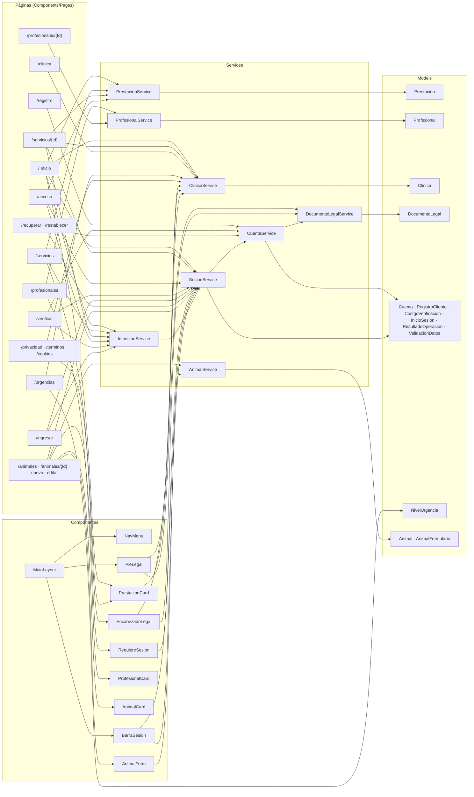

# Interfaz para computadora — `Veterinaria.Blazor`

Aplicación **Blazor Web App** en **C# / .NET 10** (interactividad Server, ubicación Global) para Visitante, Cliente, Recepción, Veterinario y Administración. Se construye en la sección A (rama `desktop`) con **datos de demostración** y se conecta a la API en la sección C.

- Abrir `Veterinaria.Blazor/Veterinaria.Blazor.slnx` en Visual Studio 2026 y ejecutar con **F5**.
- Reglas comunes: [principios vigentes](../docs/contexto-base/CONTEXTO_BASE.md#31-principios-vigentes). Convenciones del docente: [`AGENTS.md`](../AGENTS.md).
- Avance: [plan de tareas](../docs/analisis/PLAN_TAREAS_PROYECTO.md) y [bitácoras](../docs/sesiones/).

## Cómo está organizado

```
Veterinaria.Blazor/
├── Models/              Clases de datos (sin lógica): Prestacion, Profesional, Clinica, Cuenta…
├── Services/            Lógica y datos de demostración; cada uno se registra con AddScoped en Program.cs
├── Components/
│   ├── Layout/          MainLayout (marco de todas las páginas) y NavMenu (menú lateral)
│   ├── Pages/           Una página por ruta (@page)
│   └── *.razor          Componentes reutilizables: tarjetas, pie legal, barra de sesión…
├── wwwroot/             Archivos estáticos (Bootstrap, app.css)
└── Program.cs           Cultura es-UY y registro de servicios
```

Cada página **inyecta** (`@inject`) los servicios que necesita y **usa** componentes con `[Parameter]`. Los servicios trabajan con los modelos. En la sección C, cada `XxxService` se reemplaza por un `XxxApiService` que pide los mismos datos a la API con `HttpClient`, sin cambiar las páginas.

## Mapa de conexiones

Versión navegable, con «Usa» y «Usado por» de cada archivo: el cerebro de Obsidian en [`VeterinariaBrain/`](../VeterinariaBrain/00%20Mapas/Mapa%20C%C3%B3digo.md).



## Páginas

| Ruta | Archivo | Tarea | Usa |
|---|---|---|---|
| `/` | `Pages/Home.razor` | A-002 | ClinicaService, PrestacionService, IntencionService, SesionService · `PrestacionCard` |
| `/servicios` | `Pages/Servicios.razor` | A-003 | PrestacionService, IntencionService · `PrestacionCard` |
| `/servicios/{Id}` | `Pages/PrestacionDetalle.razor` | A-003, A-011 | PrestacionService, ClinicaService, IntencionService, SesionService |
| `/profesionales` | `Pages/Profesionales.razor` | A-004 | ProfesionalService · `ProfesionalCard` |
| `/profesionales/{Id}` | `Pages/ProfesionalDetalle.razor` | A-004 | ProfesionalService |
| `/clinica` | `Pages/LaClinica.razor` | A-004 | ClinicaService |
| `/urgencias` | `Pages/Urgencias.razor` | A-005 | ClinicaService · modelo `NivelUrgencia` |
| `/privacidad`, `/terminos`, `/cookies` | `Pages/Privacidad.razor`, `Terminos.razor`, `Cookies.razor` | A-005 | ClinicaService · `EncabezadoLegal` |
| `/acceso` | `Pages/Acceso.razor` | A-006, A-011 | PrestacionService, IntencionService, SesionService |
| `/registro` | `Pages/Registro.razor` | A-006 | CuentaService · modelo `RegistroCliente` |
| `/verificar` | `Pages/Verificar.razor` | A-007 | CuentaService, SesionService, IntencionService · modelo `CodigoVerificacion` |
| `/ingresar` | `Pages/Ingresar.razor` | A-008 | SesionService, IntencionService · modelo `InicioSesion` |
| `/recuperar` | `Pages/Recuperar.razor` | A-007 | CuentaService · modelo `SolicitudRecuperacion` |
| `/restablecer` | `Pages/Restablecer.razor` | A-007 | CuentaService, SesionService · modelo `NuevaContrasena` |
| `/animales` | `Pages/Animales.razor` | A-012 | AnimalService, SesionService · `AnimalCard`, `RequiereSesion` |
| `/animales/{Id}` | `Pages/AnimalDetalle.razor` | A-012 | AnimalService, SesionService · `RequiereSesion` |
| `/animales/nuevo` | `Pages/AnimalNuevo.razor` | A-013 | AnimalService, SesionService · `AnimalForm` |
| `/animales/{Id}/editar` | `Pages/AnimalEditar.razor` | A-013 | AnimalService, SesionService · `AnimalForm` |

## Servicios

| Servicio | Qué hace | Depende de | Se reemplaza en la sección C por |
|---|---|---|---|
| `PrestacionService` | Catálogo público de servicios (solo publicados y con precio) | — | `PrestacionApiService` → `GET /api/v1/servicios` |
| `ProfesionalService` | Profesionales publicados y sus horarios | — | `ProfesionalApiService` |
| `ClinicaService` | Datos de VITALIA y enlaces `tel:` | — | `ClinicaApiService` |
| `DocumentoLegalService` | Versión y fecha vigente de Privacidad, Términos y Cookies | — | Documentos servidos por la API |
| `CuentaService` | Registro, verificación por código, recuperación de contraseña y credenciales (PBKDF2) | DocumentoLegalService | `CuentaApiService` (identidad en la API) |
| `SesionService` | Cuenta que ingresó; ingresar y salir | CuentaService | Autenticación con tokens (RNF-SEG-03) |
| `AnimalService` | Animales del cliente (solo los suyos, RN-18), microchip único (RN-41), ejemplos de caballo y oveja | — | `AnimalApiService` → `/api/v1/animales` |
| `IntencionService` | Servicio elegido antes de ingresar; se retoma hasta 30 min | SesionService | Igual, en el cliente |

> Todos los servicios son `AddScoped`: en Blazor Server duran lo que dura la pestaña. Cuentas y sesión se pierden al recargar; es lo esperado hasta tener la API.
